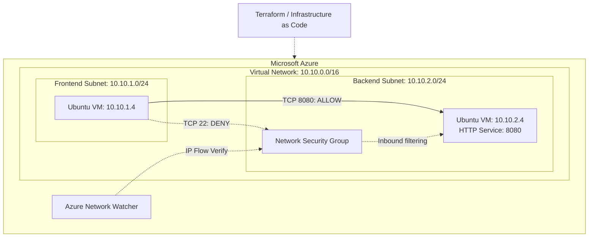

# Azure Network Segmentation with Terraform

A reproducible network security reference architecture demonstrating
east-west traffic segmentation, infrastructure automation, and
connectivity validation in Microsoft Azure.

## Overview

This project provisions two isolated application tiers within
an Azure Virtual Network and controls communication using
Network Security Groups (NSGs).

The objective is to demonstrate practical Azure networking,
security rule design, and infrastructure troubleshooting.

## Key Features

- Automated infrastructure provisioning with Terraform
- Virtual Network with frontend and backend subnets
- Subnet-level security enforcement using Azure NSGs
- Private Linux virtual machines without public IP addresses
- Automated HTTP test service deployment using cloud-init
- Network connectivity validation
- Security rule verification using Azure Network Watcher

## Architecture



## Network Security Design

The backend subnet is protected by an Azure Network Security Group.

| Priority | Source | Destination | Protocol | Action |
|---|---|---|---|---|
| 100 | 10.10.1.0/24 | 10.10.2.0/24:8080 | TCP | Allow |
| 200 | 10.10.1.0/24 | 10.10.2.0/24:* | Any | Deny |

Azure NSGs are stateful, allowing return traffic for
established connections.

The rules restrict inbound traffic originating from the
frontend subnet. They do not implement complete isolation
from every other network source.

## Prerequisites

- Azure subscription with permission to deploy networking
  and compute resources
- Existing Azure Resource Group
- Terraform >= 1.5
- Azure CLI
- SSH public key

## Deployment

### 1. Authenticate with Azure

```bash
az login
az account set --subscription "<subscription-id>"
```

### 2. Configure Terraform variables

```bash
cd terraform
cp terraform.tfvars.example terraform.tfvars
```

Adjust the subscription ID, Resource Group name,
VM size, and SSH public key path.

### 3. Initialize and validate

```bash
terraform init
terraform fmt -check
terraform validate
```

### 4. Deploy infrastructure

```bash
terraform plan
terraform apply
```

## Connectivity Validation

The following tests were successfully performed during deployment.

| Test | Expected | Observed |
|---|---|---|
| Backend HTTP service | Running | Active |
| Frontend to Backend TCP 8080 | Allowed | HTTP 200 OK |
| Frontend to Backend TCP 22 | Blocked | Connection timeout |
| Network Watcher IP Flow Verify | Deny | Deny-Frontend-All |

### HTTP Connectivity Test

Executed on the frontend VM using Azure Run Command:

```bash
curl -v --connect-timeout 5 \
  http://10.10.2.4:8080
```

Result:

```text
Connected to 10.10.2.4 port 8080
HTTP/1.0 200 OK
Azure Network Segmentation - Backend OK
```

### Network Security Verification

Azure Network Watcher IP Flow Verify returned:

```json
{
  "access": "Deny",
  "ruleName": "securityRules/Deny-Frontend-All"
}
```

This confirms that the configured NSG rule blocks
inbound SSH traffic from the frontend subnet.

## Troubleshooting and Lessons Learned

### Azure RBAC

The initial deployment failed because the training account
was not authorized to create a new Resource Group.

Resolution: Reference an existing Resource Group using
a Terraform data source.

### Azure Policy

The initial VM size was denied by an organizational Azure
Policy restricting permitted VM SKUs.

Resolution: Inspect the effective policy definition and
select a permitted VM size.

### Infrastructure Lifecycle

Terraform was used to provision, validate, and destroy
the project-managed infrastructure.

## Cleanup

Remove the deployed resources:

```bash
terraform destroy
```

The existing Resource Group is referenced as a data source
and is therefore not deleted by Terraform.

## Limitations

This is a reference implementation, not a production-ready
landing zone.

Potential improvements include:

- Centralized logging and monitoring
- Additional NSGs and explicit egress restrictions
- Private DNS integration
- Automated connectivity tests
- GitHub Actions for Terraform validation
- Remote Terraform state management
```