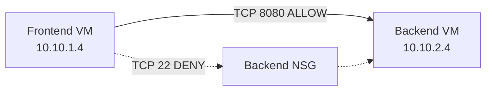

# Azure Network Segmentation with Terraform

A reproducible Azure network security reference architecture
deployed using Terraform.

## Overview

This project demonstrates subnet segmentation and controlled
east-west traffic within an Azure Virtual Network.

### Technologies

- Microsoft Azure
- Terraform
- Azure Virtual Network
- Network Security Groups
- Ubuntu Linux
- Azure Network Watcher

## Architecture

See [architecture.mmd](docs/architecture.mmd)
for the complete topology.

## Connectivity Validation

| Source | Destination | Protocol | Result |
|---|---|---|---|
| Frontend | Backend | TCP 8080 | HTTP 200 OK |
| Frontend | Backend | TCP 22 | Blocked |

Azure Network Watcher IP Flow Verify confirmed that the
`Deny-Frontend-All` security rule blocks inbound TCP 22.

## Infrastructure as Code

All project-managed resources are defined using Terraform.

The existing Azure training resource group is referenced
as a data source and is not managed by this project.

## Security

- No public IP addresses assigned to virtual machines
- SSH key-based authentication
- Backend subnet protected by an NSG
- Application traffic explicitly allowed on TCP 8080
- Other frontend-to-backend inbound traffic denied