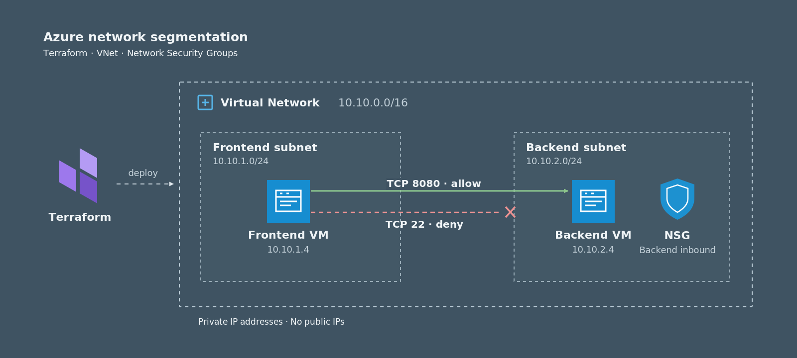

# Azure Network Segmentation with Terraform

A reproducible Azure networking reference implementation demonstrating **east-west traffic filtering**, **Infrastructure as Code**, and **network troubleshooting**.

## Overview

This project deploys two Ubuntu virtual machines into separate subnets of an Azure Virtual Network (VNet). A Network Security Group (NSG) attached to the backend subnet permits HTTP traffic from the frontend subnet on TCP 8080 and denies other inbound traffic originating from that subnet.

The infrastructure is provisioned with Terraform, the backend HTTP service is configured with cloud-init, and the security rules are validated through connectivity tests and Azure Network Watcher.

### Key features

- Reproducible Azure infrastructure managed with Terraform
- Frontend and backend subnets within one VNet
- Subnet-level inbound traffic filtering with an NSG
- Two private Ubuntu VMs without public IP addresses
- Automated backend HTTP service configuration via cloud-init
- Connectivity tests and NSG rule verification with Azure Network Watcher
- GitHub Actions workflow for Terraform formatting and validation

## Architecture



[View the editable Mermaid architecture diagram](docs/architecture.mmd).

| Component | Configuration |
| --- | --- |
| Virtual Network | `10.10.0.0/16` |
| Frontend subnet | `10.10.1.0/24` |
| Backend subnet | `10.10.2.0/24` |
| Frontend VM | Ubuntu Linux, private NIC |
| Backend VM | Ubuntu Linux, HTTP service on TCP 8080 |
| Network Security Group | Associated with the backend subnet |

The VM addresses shown in the diagram (`10.10.1.4` and `10.10.2.4`) were observed during the test deployment. Both NICs use dynamic private IP allocation, so addresses can change between deployments.

## Network Security Design

The backend NSG applies the following **inbound** rules, evaluated in priority order:

| Priority | Source | Destination | Protocol | Action |
| --- | --- | --- | --- | --- |
| 100 | `10.10.1.0/24` | `10.10.2.0/24`, port `8080` | TCP | Allow |
| 200 | `10.10.1.0/24` | `10.10.2.0/24`, all ports | Any | Deny |

Azure NSGs are stateful: response traffic for an allowed connection is permitted without a separate inbound or outbound rule for the reply.

**Scope:** These rules restrict inbound connections **from the frontend subnet to the backend subnet**. They do not provide complete backend isolation from every source or explicitly restrict outbound traffic. Other traffic is subject to the remaining default NSG rules.

Neither VM has a public IP address. Administrative commands and connectivity tests were executed using Azure VM Run Command.

## Prerequisites

- An Azure subscription with permission to deploy virtual networks, NICs, NSGs, and virtual machines
- An **existing** Azure Resource Group
- An allowed VM SKU in the Resource Group's region (default: `Standard_B1s`)
- [Terraform](https://developer.hashicorp.com/terraform/install) >= 1.5
- [Azure CLI](https://learn.microsoft.com/en-us/cli/azure/install-azure-cli)
- An SSH public key (default path: `~/.ssh/id_ed25519.pub`)

The AzureRM provider uses the Resource Group's existing region. The project does not create or delete the Resource Group.

## Deployment

### 1. Authenticate with Azure

```bash
az login
az account set --subscription "<subscription-id>"
```

### 2. Configure Terraform

From the repository root:

```bash
cd terraform
cp terraform.tfvars.example terraform.tfvars
```

Edit `terraform.tfvars` for your environment:

```hcl
subscription_id     = "<subscription-id>"
resource_group_name = "<existing-resource-group>"
vm_size             = "Standard_B1s"
ssh_public_key_path = "~/.ssh/id_ed25519.pub"
```

The VM size must be allowed by both subscription availability and any applicable Azure Policies. Do not commit `terraform.tfvars`, Terraform state files, or saved plan files.

### 3. Initialize and validate

```bash
terraform init
terraform fmt -check
terraform validate
```

### 4. Deploy

```bash
terraform plan
terraform apply
```

Terraform provisions the VNet, two subnets, the backend NSG and its subnet association, two NICs, and two Linux VMs. Cloud-init starts the HTTP test service on the backend VM.

## Connectivity Validation

The following results were observed during a successful deployment:

| Test | Expected | Observed |
| --- | --- | --- |
| Backend HTTP service, locally | Running | `active`, HTTP response received |
| Frontend → Backend, TCP 8080 | Allowed | HTTP `200 OK` |
| Frontend → Backend, TCP 22 | Not reachable | Connection attempt timed out |
| Network Watcher IP Flow Verify, TCP 22 | Deny | `securityRules/Deny-Frontend-All` |

### HTTP test

Run the command **on the frontend VM** using Azure VM Run Command (replace the IP if it differs from your deployment):

```bash
az vm run-command invoke \
  --resource-group "<existing-resource-group>" \
  --name vm-frontend \
  --command-id RunShellScript \
  --scripts 'curl -sS -i --connect-timeout 5 --max-time 10 http://10.10.2.4:8080'
```

Observed response:

```text
HTTP/1.0 200 OK
Azure Network Segmentation - Backend OK
```

### Blocked SSH test

From the frontend VM, attempt a TCP connection to the backend on port 22:

```bash
az vm run-command invoke \
  --resource-group "<existing-resource-group>" \
  --name vm-frontend \
  --command-id RunShellScript \
  --scripts "timeout 7 bash -c 'echo > /dev/tcp/10.10.2.4/22' && echo 'SSH reachable' || echo 'SSH not reachable'"
```

The connection was not established. A failed connection alone does not identify the blocking component, so the NSG decision was checked separately.

### Verify the NSG decision

```bash
az network watcher test-ip-flow \
  --resource-group "<existing-resource-group>" \
  --vm vm-backend \
  --direction Inbound \
  --protocol TCP \
  --local 10.10.2.4:22 \
  --remote 10.10.1.4:50000 \
  -o json
```

Observed result:

```json
{
  "access": "Deny",
  "ruleName": "securityRules/Deny-Frontend-All"
}
```

This confirms that the configured backend NSG rule denies the specified inbound SSH flow.

## CI: Terraform Validation

The workflow at [`.github/workflows/terraform-validate.yml`](.github/workflows/terraform-validate.yml) runs Terraform formatting and configuration validation on relevant pushes and pull requests, and can be triggered manually.

It runs `terraform fmt -check`, `terraform init -backend=false`, and `terraform validate`. **It does not authenticate to Azure, create resources, or perform a deployment.**

## Troubleshooting and Lessons Learned

### Azure RBAC

The initial deployment failed with `AuthorizationFailed` because the training account could not create or read a new Resource Group at the requested scope. The configuration was changed to reference an existing Resource Group using an `azurerm_resource_group` data source.

### Azure Policy and VM SKUs

A VM deployment returned `RequestDisallowedByPolicy` because the requested SKU was excluded by an organization-level Azure Policy. Inspecting the policy definition revealed the permitted SKUs; switching to `Standard_B1s` allowed deployment.

**Lesson:** A VM SKU appearing available in the Azure CLI does not guarantee that organizational policies permit its deployment.

## Cleanup

From the `terraform/` directory:

```bash
terraform plan -destroy
terraform destroy
```

Review the destroy plan before confirming. Terraform removes the project-managed resources, while the existing Resource Group—referenced as a data source—remains untouched.

The deployment used for the connectivity tests was successfully removed with `terraform destroy`.

## Limitations and Possible Improvements

This is a small, tested reference implementation—not a production-ready network security architecture.

Possible next steps include:

- More restrictive ingress and egress policies
- Network-level logging and centralized monitoring
- Private DNS and more realistic multi-tier service discovery
- Automated end-to-end connectivity tests in CI/CD
- Remote Terraform state with appropriate access controls
- More configurable address spaces, VM images, and naming conventions